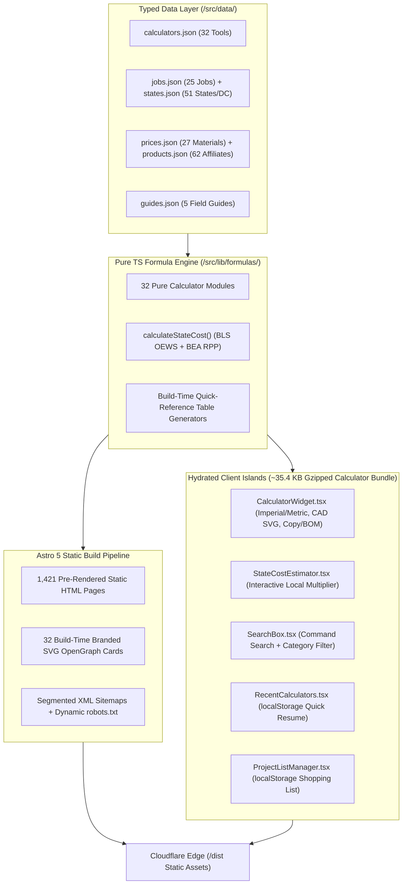

<div align="center">

# 🏗️ BuildMath

### Source-Cited DIY & Residential Construction Calculators + Programmatic US Cost Engine

[](https://github.com/Kabirroy12345/BuildMath/actions/workflows/ci.yml)
[](https://buildmath.kabir-23bce10815.workers.dev/)
[](https://astro.build/)
[](https://preactjs.com/)
[](https://www.typescriptlang.org/)
[](https://tailwindcss.com/)
[](./tests/unit/formulas.test.ts)

**1,421 Pre-Rendered Static HTML Pages** • **32 Deterministic Trade Calculators** • **1,275 State Cost Guides** • **~35.4 KB Gzipped Calculator JS** • **Light & Graphite Dark Modes**

[🌐 **Visit Live Site (`buildmath.kabir-23bce10815.workers.dev`)**](https://buildmath.kabir-23bce10815.workers.dev/) · [🧮 **Browse Calculators**](https://buildmath.kabir-23bce10815.workers.dev/calculators/) · [💵 **Cost Guides**](https://buildmath.kabir-23bce10815.workers.dev/cost/) · [📐 **Methodology**](https://buildmath.kabir-23bce10815.workers.dev/methodology/) · [🚀 **Launch Playbook**](./LAUNCH.md)

</div>

---

## 📖 Table of Contents

1. [Overview & Core Engineering Philosophy](#-1-overview--core-engineering-philosophy)
2. [System Architecture & Data Flow](#-2-system-architecture--data-flow)
3. [Complete 32-Calculator Matrix (8 Trades)](#-3-complete-32-calculator-matrix-8-trades)
4. [Programmatic State Cost Engine (1,300 Pages)](#-4-programmatic-state-cost-engine-1300-pages)
5. [Technical SEO, Structured Data & Guardrails](#-5-technical-seo-structured-data--guardrails)
6. [Monetization & Conversion Architecture](#-6-monetization--conversion-architecture)
7. [Performance & Build Benchmarks](#-7-performance--build-benchmarks)
8. [Repository Structure](#-8-repository-structure)
9. [Quick Start & CLI Commands](#-9-quick-start--cli-commands)
10. [How to Add a New Calculator in 5 Steps](#-10-how-to-add-a-new-calculator-in-5-steps)
11. [Deployment (Cloudflare Workers & Pages)](#-11-deployment-cloudflare-workers--pages)

---

## 🎯 1. Overview & Core Engineering Philosophy

**BuildMath** is a high-speed, zero-backend residential construction estimation platform engineered to deliver accurate material takeoffs and localized contractor cost estimates in **under 10 seconds on mobile**.

Unlike typical client-rendered SPA calculator sites that suffer from poor search indexing and return unpurchasable decimal numbers (e.g., `2.37 cubic yards`), BuildMath is built around four strict engineering principles:

- **100% Pre-Rendered Static HTML (Zero-SPA Indexing Penalty):** Every calculator, quick-reference chart, worked example, FAQ, and state cost breakdown is compiled into static HTML at build time via **Astro 5**.
- **Pure, Zero-DOM Mathematical Core:** All 32 calculator formulas and the regional cost engine live in pure TypeScript modules under [`src/lib/formulas/`](./src/lib/formulas/) with **100 unit tests** verifying standard inputs, edge cases, and store-unit ceiling rounding.
- **Purchasable Store Units + Exact Engineering Math:** Every calculator simultaneously computes the exact unrounded engineering value and rounds **up** (`Math.ceil`) to real store packaging—80-lb/60-lb/40-lb concrete bags, 5-gallon paint pails, 3-bundle roofing squares, 12-ft carpet roll lengths, and 4×8/4×12 drywall sheets.
- **Transparent, Editable Trade Defaults:** Every coverage rate, mortar joint thickness, waste factor, and unit price cites its industry source (ACI, NRCA, ARMA, NWFA, TCNA, USG, 2024 IRC) and can be customized live by the user.

---

## 🏛️ 2. System Architecture & Data Flow



---

## 🧮 3. Complete 32-Calculator Matrix (8 Trades)

Every calculator supports **Imperial (`ft` / `in`) & Metric (`m` / `cm`) toggles**, **editable coverage/price defaults**, **waste-factor sliders**, **shareable query-parameter URLs**, **print-clean stylesheets**, and **one-click saving to `/my-project/`**.

| # | Trade Category | Calculator Name | Route | Core Formula & Industry Standard |
| :- | :--- | :--- | :--- | :--- |
| 1 | **Painting** | Interior Paint Calculator | `/calculators/paint-calculator/` | $\text{Wall Area} = 2(L+W)H - 21D - 15W + \text{Ceiling}$; $350\text{ sq ft/gal}$ |
| 2 | **Painting** | Exterior House Paint Calculator | `/calculators/exterior-paint-calculator/` | $\text{Perimeter} \times H + \text{Gable Triangles} - \text{Openings}$; 1-gal & 5-gal pails |
| 3 | **Painting** | Deck Stain & Sealer Calculator | `/calculators/deck-stain-calculator/` | $\text{Deck Footprint} + \text{Railings (2 sides)} + \text{Stairs}$; 1st vs. 2nd coat rates |
| 4 | **Painting** | Wallpaper Roll Calculator | `/calculators/wallpaper-calculator/` | $\text{Net Wall Area} \div \text{Usable Single/Double Roll Yield} + \text{Pattern Repeat}$ |
| 5 | **Flooring** | Flooring Calculator (LVP / Hardwood) | `/calculators/flooring-calculator/` | $(\text{Main Area} + \text{L-Wing}) \times (1 + \text{Waste}) \div \text{Sq Ft per Carton}$ |
| 6 | **Flooring** | Ceramic & Porcelain Tile Calculator | `/calculators/tile-calculator/` | $\lceil \text{Area}_{\text{in}^2} \div ((W_{\text{tile}}+G)(L_{\text{tile}}+G)) \times (1+\text{Waste}) \rceil$ + Thinset |
| 7 | **Flooring** | Tile Grout Calculator | `/calculators/grout-calculator/` | $\frac{L+W}{L \times W} \times W_{\text{joint}} \times D_{\text{joint}} \times \text{Area} \times \text{Density}$ (TCNA) |
| 8 | **Flooring** | Carpet & Padding Calculator | `/calculators/carpet-calculator/` | $\text{Sq Ft} \div 9 = \text{Sq Yd}$; 12-ft broadloom roll linear length & pad |
| 9 | **Flooring** | Baseboard & Trim Calculator | `/calculators/baseboard-trim-calculator/` | $(\text{Perimeter} - \text{Door Widths}) \times (1 + \text{Waste})$ in 8/12/16-ft boards |
| 10 | **Concrete** | Concrete Slab Calculator | `/calculators/concrete-slab-calculator/` | $L \times W \times (T_{\text{in}}\div 12) \div 27$; Ready-mix $\text{yd}^3$ vs. 80/60/40-lb bags |
| 11 | **Concrete** | Footing, Column & Sonotube Calculator | `/calculators/concrete-footing-calculator/` | Cylinder $\pi r^2 h$ & Rectangular $L \times W \times D \times \text{Quantity}$ |
| 12 | **Concrete** | Concrete Steps & Landing Calculator | `/calculators/concrete-steps-calculator/` | $\sum_{i=1}^{n} (\text{Run} \times \text{Width} \times i \cdot \text{Rise}) + \text{Landing Volume}$ |
| 13 | **Concrete** | Brick & Mortar Calculator | `/calculators/brick-calculator/` | $\text{Net Wall Area} \times 6.75\text{ modular bricks/sq ft}$ ($\frac{3}{8}\text{"}$ joint, BIA) + Type N mortar |
| 14 | **Concrete** | Paver Patio Base & Sand Calculator | `/calculators/paver-patio-calculator/` | Paver count + compacted crusher-run base (tons) + 1" ASTM C33 bedding sand |
| 15 | **Concrete** | Retaining Wall Block Calculator | `/calculators/retaining-wall-calculator/` | Courses (incl. buried base row) $\times$ blocks/row + cap blocks + drainage stone |
| 16 | **Concrete** | Rebar Grid & Bar Calculator | `/calculators/rebar-calculator/` | Continuous bar runs from edge-cover inset, OC grid spacing & lap-splice % |
| 17 | **Roofing** | Roofing Shingle & Bundle Calculator | `/calculators/roofing-calculator/` | $\text{Footprint} \times \sqrt{1+(\text{Rise}\div 12)^2} \div 100 = \text{Squares}$ (3 bundles/sq, ARMA) |
| 18 | **Roofing** | Roof Pitch & Angle Calculator | `/calculators/roof-pitch-calculator/` | Rise/12 $\leftrightarrow$ Degrees $\arctan(\text{Rise}/12) \leftrightarrow$ Secant Pitch Factor + SVG |
| 19 | **Roofing** | Rain Gutter & Downspout Calculator | `/calculators/gutter-calculator/` | Eave linear ft, 10-ft sections, hidden hangers (24" OC), downspouts & elbows |
| 20 | **Roofing** | Vinyl Siding Square Calculator | `/calculators/siding-calculator/` | $(\text{Wall} + \text{Gables} - \text{Openings}) \div 100$ + J-channel & corner posts |
| 21 | **Landscaping** | Mulch Cubic Yard & Bag Calculator | `/calculators/mulch-calculator/` | $\text{Area} \times (D_{\text{in}}\div 12) \div 27 = \text{yd}^3$; $13.5\text{ bags (2 cu ft)}$ per $\text{yd}^3$ |
| 22 | **Landscaping** | Gravel & Crushed Stone Tonnage | `/calculators/gravel-calculator/` | $\text{Volume}_{\text{yd}^3} \times \text{Material Density}$ ($1.35\text{–}1.50\text{ tons/yd}^3$) |
| 23 | **Landscaping** | Topsoil & Raised Bed Calculator | `/calculators/topsoil-calculator/` | Bulk cubic yards, screened topsoil tonnage & 0.75 / 1.0 / 2.0 cu ft bags |
| 24 | **Landscaping** | Sod Roll & Pallet Calculator | `/calculators/sod-calculator/` | $\text{Lawn Area} \times 1.05$ in $10\text{ sq ft}$ rolls & $450\text{ sq ft}$ pallets |
| 25 | **Landscaping** | Grass Seed Rate Calculator | `/calculators/grass-seed-calculator/` | $(\text{Sq Ft}\div 1,000) \times \text{Cultivar Rate}$ (New Lawn vs. Overseeding) |
| 26 | **Fencing/Deck** | Wood Fence Post, Rail & Picket Calc | `/calculators/fence-calculator/` | $\lceil L \div \text{Spacing}\rceil + 1$ posts, rails, pickets & post-hole concrete bags |
| 27 | **Fencing/Deck** | Deck Board, Joist & Fastener Calc | `/calculators/deck-calculator/` | Decking boards (12/16/20-ft), joists (12/16/24" OC), ledger & hidden fasteners |
| 28 | **Drywall/Walls** | Drywall Sheet, Mud, Tape & Screw Calc | `/calculators/drywall-calculator/` | 4×8 / 4×12 sheets + USG handbook mud ($1.125\text{ gal/100 sq ft}$), tape & screws |
| 29 | **Drywall/Walls** | Stair Stringer & IRC Code Calculator | `/calculators/stair-calculator/` | Risers, treads, stringer hypotenuse & **2024 IRC R311.7.5 compliance check** |
| 30 | **Conversions** | Square Footage Calculator | `/calculators/square-footage-calculator/` | Multi-shape area ($\text{ft}^2$, $\text{yd}^2$, $\text{m}^2$, acres) + unit cost estimator |
| 31 | **Conversions** | Cubic Yard Calculator | `/calculators/cubic-yard-calculator/` | Rectangular & circular prism volume ($\text{ft}^3 \leftrightarrow \text{yd}^3 \leftrightarrow \text{m}^3$) |
| 32 | **Conversions** | Lumber Board Foot Calculator | `/calculators/board-foot-calculator/` | $\text{BF} = \frac{\text{Thickness}_{\text{in}} \times \text{Width}_{\text{in}} \times \text{Length}_{\text{ft}}}{12} \times \text{Pieces}$ |

---

## 🗺️ 4. Programmatic State Cost Engine (1,300 Pages)

BuildMath generates **25 National Cost Guides** (`/cost/[job]/`) and **1,275 State Cost Pages** (`/cost/[job]/[state]/` across all 50 US states + Washington, DC).

### Composite Regional Cost Formula
Implemented in [`src/lib/formulas/state-cost.ts`](./src/lib/formulas/state-cost.ts):

$$\text{State Cost} = \text{National Cost} \times \left[ \text{Labor Share} \times \left(\frac{\text{State BLS Trade Wage}}{\text{National BLS Trade Wage}}\right) + (1 - \text{Labor Share}) \times \left(\frac{\text{State BEA RPP}}{100}\right) \right]$$

Each state page renders genuinely localized data from [`src/data/costs/states.json`](./src/data/costs/states.json):
1. **BLS OEWS Trade Wages:** Occupation-specific hourly wages for Roofers (`47-2181`), Painters (`47-2141`), Carpenters (`47-2031`), Cement Masons (`47-2051`), Tile Setters (`47-2044`), Carpet Installers (`47-2041`), Drywall Installers (`47-2081`), and Construction Laborers (`47-2061`).
2. **BEA Regional Price Parities (RPP):** State material cost index.
3. **IECC Climate Zone & Structural Notes:** Freeze-thaw frost line depths, hurricane wind-borne debris zones, and moisture considerations.
4. **State Contractor Licensing Board Verification:** Official state licensing agency name, permit thresholds, and direct `.gov` lookup URL.
5. **Neighboring States Comparison Table:** Dynamic cost comparison against bordering states.

---

## 🔍 5. Technical SEO, Structured Data & Guardrails

- **Bottom-Up Flagship Cost Verification & Noindex Guardrail:** Jobs in [`src/data/costs/jobs.json`](./src/data/costs/jobs.json) carry a `"verified"` flag. Currently **3 flagship jobs** (`roof-replacement`, `interior-painting`, `concrete-patio`) are verified bottom-up from BuildMath calculator takeoffs (`prices.json`) plus BLS OEWS crew hours; the remaining 22 draft jobs output `<meta name="robots" content="noindex, follow">` and are excluded from [`sitemap-cost.xml`](./src/pages/sitemap-cost.xml.ts).
- **Batch State Rollout (`indexedStates`):** [`src/config/seo.ts`](./src/config/seo.ts) restricts state indexing to the 10 most populous states in Batch 1 (30 state pages + 3 national guides + 1 `/cost/` hub = 34 indexed cost URLs), preventing programmatic crawl spikes.
- **Rich JSON-LD Schema Graph (`src/lib/seo/schema.ts`):**
  - `WebSite` (with `SearchAction`) + `Organization` on `/`
  - `BreadcrumbList` on every page
  - `WebApplication` + `FAQPage` on all 32 calculator pages
  - `Article` + `FAQPage` on all cost guides and how-to articles
- **Automated Link & Orphan Auditing:** [`scripts/orphan-check.ts`](./scripts/orphan-check.ts) parses all 1,421 generated HTML files in `dist/` after every build to guarantee **0 broken internal links** and **0 orphan indexed pages**.

---

## 💰 6. Monetization & Conversion Architecture

Controlled centrally via [`src/config/monetization.ts`](./src/config/monetization.ts) (all paid flags start disabled until approved):

1. **Primary Result Material CTA & Shopping List (`affiliateEnabled: false` at launch):**
   - Disabled until affiliate accounts (Amazon Associates / Impact) are approved so disclosure statements remain strictly accurate. When enabled, calculators display high-intent CTA links routed through `/go/[id]/` with `rel="sponsored nofollow noopener"` and `meta noindex, nofollow`.
2. **Zero-CLS Display Ad Containers (`adsEnabled: false` at launch):**
   - [`src/components/AdSlot.astro`](./src/components/AdSlot.astro) reserves fixed minimum heights (`250px` / `90px`) and never renders above or inside the calculator widget, guaranteeing `CLS = 0.00`.
3. **Consent Management (`cmpEnabled: false` at launch):**
   - Keeps custom consent UI disabled at launch; when display ads are activated, enable Google AdSense's certified TCF v2.2 CMP for EEA/UK traffic rather than a custom non-certified banner.
4. **Contractor Lead-Gen Widget (`leadGenEnabled: false` at launch):**
   - [`src/components/LeadGenWidget.astro`](./src/components/LeadGenWidget.astro) sits on cost pages, ready to activate ZIP-code contractor quote matching once organic traffic matures.

---

## ⚡ 7. Performance & Build Benchmarks

| Metric | Target | Actual Build Output |
| :--- | :--- | :--- |
| **Total Static HTML Pages** | 1,350+ | **1,421 pages** (+ 32 SVG OG images + 5 XML sitemaps) |
| **Full Static Build Time** | `< 60s` | **8.74 seconds** |
| **Calculator Route JS (Gzipped)** | `< 70 KB` | **~36.8 KB** (`CalculatorWidget`: `23.73 KB`, `Preact`: `4.48 KB`, `Signals`: `3.09 KB`, `LucideIcon`: `2.91 KB`) |
| **Formula Unit Tests** | 90+ | **100 / 100 passed** (`vitest run`) |
| **Playwright E2E Suite** | Desktop & Mobile | **10 / 10 passed** (all 32 calculators, 8 categories, search, validation, overflow & console checks) |
| **Broken Links / Orphan Pages** | `0` | **0 broken links / 0 orphan pages** (`npm run orphan:check`) |

---

## 📂 8. Repository Structure

```text
BuildMath/
├── .github/
│   └── workflows/
│       └── ci.yml                  # GitHub Actions CI: test, data:check, build, orphan:check
├── public/
│   ├── fonts/                      # Self-hosted Geist, Inter & JetBrains Mono variable WOFF2 fonts
│   ├── _headers                    # HSTS, CSP, X-Frame-Options, immutable asset caching
│   ├── _redirects                  # 301 canonical redirects
│   ├── ads.txt                     # Google AdSense / authorized digital sellers declaration
│   ├── favicon.svg                 # Branded SVG icon
│   ├── llms.txt                    # AI/LLM structured site directory
│   └── og-default.svg              # Default 1200x630 OpenGraph card
├── scripts/
│   ├── data-check.ts               # Validates JSON schemas, formula registry & SEO char limits
│   ├── indexnow.ts                 # IndexNow instant ping utility for Bing/Yandex
│   └── orphan-check.ts             # Static HTML crawler verifying 0 broken links & 0 orphans
├── src/
│   ├── components/
│   │   ├── AdSlot.astro            # Zero-CLS reserved-height ad container
│   │   ├── Breadcrumbs.astro       # Accessible breadcrumb nav + BreadcrumbList JSON-LD
│   │   ├── CalculatorWidget.tsx    # Precision CAD-style Preact calculator & BOM island
│   │   ├── ConsentBanner.astro     # Google Consent Mode v2 banner
│   │   ├── FAQSection.astro        # Collapsible <details> FAQ + FAQPage JSON-LD
│   │   ├── Icon.astro              # Zero-dependency Lucide SVG icon helper for Astro
│   │   ├── LeadGenWidget.astro     # Feature-flagged ZIP-code contractor quote box
│   │   ├── LucideIcon.tsx          # Zero-dependency Lucide SVG icon helper for Preact
│   │   ├── ProjectListManager.tsx  # Combined localStorage shopping list & print manager
│   │   ├── RecentCalculators.tsx   # Recently used calculator quick-resume island
│   │   ├── SearchBox.tsx           # Command-bar search + category filter grid
│   │   └── StateCostEstimator.tsx  # Interactive regional project cost & split estimator
│   ├── config/
│   │   ├── monetization.ts         # Ads, affiliate, lead-gen & CMP feature flags
│   │   ├── seo.ts                  # Batch state indexing controls & character limits
│   │   └── site.ts                 # Brand, domain, source citations & env variable bindings
│   ├── data/
│   │   ├── calculators.json        # 32 complete calculator definitions
│   │   ├── categories.json         # 8 trade categories
│   │   ├── guides.json             # 5 how-to measurement articles
│   │   ├── prices.json             # 27 national material unit prices with lastReviewed dates
│   │   ├── products.json           # 62 retail product links (Home Depot & Amazon)
│   │   └── costs/
│   │       ├── jobs.json           # 25 residential jobs (national baselines & labor shares)
│   │       └── states.json         # 51 US states/DC (BLS wages, BEA RPP, climate & licensing)
│   ├── layouts/
│   │   ├── ArticleLayout.astro     # Layout for guides & legal pages
│   │   ├── BaseLayout.astro        # Root HTML5 shell, SEO head, sticky header & footer
│   │   ├── CalculatorLayout.astro  # Calculator shell with WebApplication schema
│   │   └── CostLayout.astro        # Cost guide shell with Article schema
│   ├── lib/
│   │   ├── formulas/               # 32 pure TS calculator modules + state-cost.ts + units.ts
│   │   ├── lucide-icons.ts         # Shared 24x24 Lucide SVG path registry
│   │   └── seo/                    # meta.ts & schema.ts JSON-LD builders
│   └── pages/                      # Astro file-based routes, XML sitemaps, OG SVG & robots.txt
├── tests/
│   ├── e2e/smoke.spec.ts           # Playwright desktop & mobile E2E suite (10 checks)
│   └── unit/formulas.test.ts       # 100 Vitest unit tests across all formulas
├── LAUNCH.md                       # Step-by-step post-launch & monetization playbook
├── wrangler.jsonc                  # Cloudflare Workers static assets configuration
├── astro.config.mjs                # Astro 5 static export configuration
├── tailwind.config.mjs             # Tailwind CSS configuration
├── tsconfig.json                   # Strict TypeScript configuration
└── vitest.config.ts                # Vitest unit test configuration
```

---

## 💻 9. Quick Start & CLI Commands

### Prerequisites
- **Node.js** `>= 20.x`
- **npm** `>= 10.x`

### Installation & Local Development
```bash
# Clone the repository
git clone https://github.com/Kabirroy12345/BuildMath.git
cd BuildMath

# Install dependencies
npm install

# Start the local Astro dev server with hot reload at http://localhost:4321
npm run dev
```

### Verification, Testing & Production Build
```bash
# 1. Run all 100 Vitest formula unit tests
npm test

# 2. Validate JSON datasets, formula coverage, and SEO title/description limits
npm run data:check

# 3. Build all 1,421 static HTML pages into ./dist
npm run build

# 4. Crawl ./dist to verify 0 broken internal links and 0 orphan pages
npm run orphan:check

# 5. Preview the production static build locally
npm run preview
```

---

## 🛠️ 10. How to Add a New Calculator in 5 Steps

1. **Create the Pure Formula Module:** Add `src/lib/formulas/<slug>.ts` exporting `calculate<Name>(input): CalculationResult` and `get<Name>QuickReference(): QuickReferenceRow[]`.
2. **Register the Formula:** Import and register both functions under `<slug>` in [`src/lib/formulas/index.ts`](./src/lib/formulas/index.ts).
3. **Write Unit Tests:** Add 3+ test cases (standard, edge case, and purchasable unit rounding) in [`tests/unit/formulas.test.ts`](./tests/unit/formulas.test.ts) and run `npm test`.
4. **Add Calculator Content & Metadata:** Append the calculator specification (`inputs`, `quickReferenceMeta`, `howToCalculate`, `tipsAndMistakes`, `faqs`) to [`src/data/calculators.json`](./src/data/calculators.json).
5. **Verify & Build:** Run `npm run data:check && npm run build && npm run orphan:check`. Astro automatically generates `/calculators/<slug>/`, its `/og/calculators-<slug>.svg` social image, and adds it to `/sitemap-calculators.xml`.

---

## ☁️ 11. Deployment (Cloudflare Workers & Pages)

This repository includes both [`wrangler.jsonc`](./wrangler.jsonc) (for **Cloudflare Workers Static Assets**) and `public/_headers` + `public/_redirects` (for **Cloudflare Pages**).

| Setting | Value |
| :--- | :--- |
| **Build command** | `npm run build` |
| **Build output directory** | `dist` |
| **Deploy command (Workers)** | `npx wrangler deploy` |
| **Optional Env Vars** | `PUBLIC_SITE_URL` (e.g. `https://buildmath.com`), `PUBLIC_WEB3FORMS_KEY` |

For the complete post-launch checklist—including Google Search Console verification, Amazon Associates 180-day timing rules, W-8BEN/Payoneer setup, and AdSense/Mediavine/Raptive progression—read **[LAUNCH.md](./LAUNCH.md)**.
